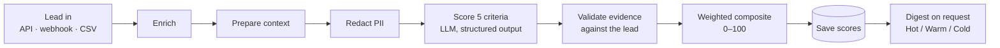
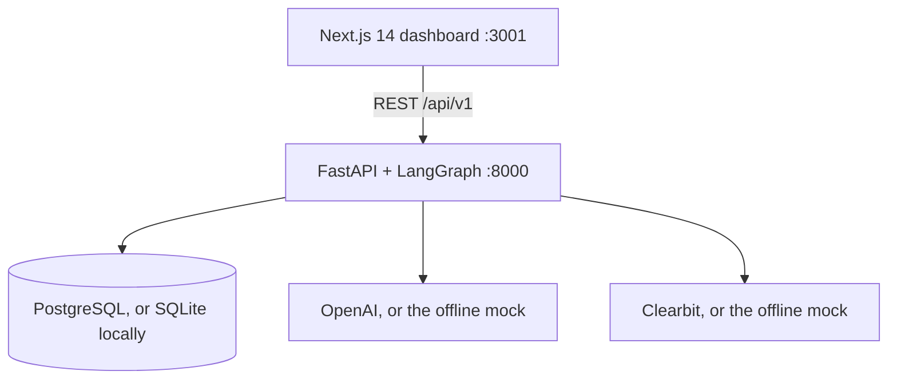

<div align="center">

# QualiSift: AI sales lead qualifier

**Scores incoming leads against five weighted criteria, checks every cited fact against the lead's
own data, and sorts them into Hot, Warm and Cold.**

[](https://github.com/arslanvuzmal/QualiSift/actions/workflows/ci.yml)


</div>

QualiSift was previously called Cortex; some code and docs still use that name.

---

## What it does

1. **A lead comes in**: from the API (`POST /leads`), a CRM webhook (`POST /webhooks/inbound`) or a
   CSV file imported on the dashboard.
2. **Enrichment** adds company data (industry, size, location, tech stack, funding).
3. **A LangGraph agent scores it** on five criteria, each 0–10, with reasoning and the evidence it used.
   Emails are hashed and phone numbers masked before anything reaches the model.
4. **The validator checks the answer**: every piece of cited evidence must appear in the lead record
   (fuzzy match, threshold 0.85), criterion names must be valid and scores in range.
5. **A weighted composite (0–100)** puts the lead in a segment: **Hot ≥ 75**, **Warm 40–74**, **Cold < 40**.
6. **A digest** groups scored leads by segment and sends it (console, SMTP or SendGrid; Slack optional).
   It is generated on request; there is no scheduler.

Default weights: ICP fit 0.30, buying intent 0.25, authority 0.20, pain/need 0.15, timing 0.10.
They can be changed on the Criteria page and must add up to 1.





---

## Run the demo (no API keys, no Docker)

Demo mode uses a deterministic mock model and mock enrichment, and SQLite. Nothing leaves your machine.

```bash
# API
cd apps/api
python -m venv .venv
. .venv/Scripts/activate          # macOS/Linux: . .venv/bin/activate
pip install -e ".[dev]"
printf "DATABASE_URL=sqlite+aiosqlite:///./dev.db\nLLM_PROVIDER=mock\nENRICHMENT_PROVIDER=mock\n" > .env
python -m scripts.seed            # 5 criteria + 5 sample leads (unscored)
uvicorn app.main:app --port 8000

# Dashboard (second terminal)
cd apps/web
npm install
echo "NEXT_PUBLIC_API_URL=http://localhost:8000" > .env.local
npm run dev                       # http://localhost:3001
```

Then:

- Score the seeded leads: open a lead and press **Re-score**, or `POST /api/v1/leads/{id}/score`.
- Add new ones: **Import CSV** on the dashboard with [`samples/leads.csv`](samples/leads.csv). Each row is
  created through `POST /leads` and scored in the background; the table refreshes every 5 seconds.
- **Generate Digest** on the dashboard; the console email provider prints it in the API log.
- API docs: http://localhost:8000/docs

All names and companies in the sample data are made up. `scripts/seed_showcase.py` inserts 100+ leads
with **random** scores for UI work; those scores do not come from the pipeline.

### Docker

```bash
cp .env.example .env
docker compose up --build
```

Postgres, Redis, the API (migrates and seeds on start) and the dashboard, on the same ports.

---

## Configuration

| Variable | Default | Notes |
|---|---|---|
| `DATABASE_URL` | Postgres | `sqlite+aiosqlite:///./dev.db` for local demo mode |
| `LLM_PROVIDER` | `mock` | `mock` (offline, deterministic) or `openai` (needs `OPENAI_API_KEY`) |
| `ENRICHMENT_PROVIDER` | `mock` | `mock` or `clearbit` (needs `CLEARBIT_API_KEY`) |
| `EMAIL_PROVIDER` | `console` | `console`, `smtp` or `sendgrid` |
| `SLACK_WEBHOOK_URL` | unset | Post digests to Slack when set |
| `PII_SALT` | unset | Salt for hashing emails before they reach the model |

See [`.env.example`](.env.example) for the full list.

---

## Tests

```bash
cd apps/api && pytest            # unit tests + an end-to-end smoke test (app, SQLite, mock providers)
cd apps/web && npm run type-check
```

CI runs both on every push and pull request, plus ruff and a `docker compose config` check.

---

## API (`/api/v1`)

| Method | Endpoint | Purpose |
|---|---|---|
| `POST` | `/leads` | Create a lead; enrichment and scoring run in the background (202) |
| `GET` | `/leads`, `/leads/{id}` | List, or one lead with scores and evidence |
| `POST` | `/leads/{id}/score` | Score again |
| `GET` / `PUT` | `/criteria` | Read or change weights |
| `POST` | `/digest/generate` | Build and send a digest |
| `GET` | `/digest/history` | Past digests |
| `POST` | `/webhooks/inbound` | HubSpot, Marketo or generic JSON |
| `GET` | `/health` | Database and Redis health |

---

## Project layout

```
apps/api/    FastAPI app: agents/ (graph, prompts, validator), adapters/ (email, enrichment,
             notifications), services/, routers/, models/, utils/ (PII, crypto), tests/
apps/web/    Next.js 14 dashboard
samples/     Sample CSV for the import
docs/        Architecture and setup notes
```

## Licence

[MIT](LICENSE)
