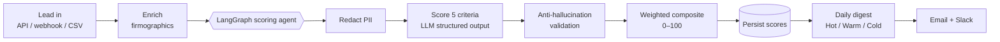
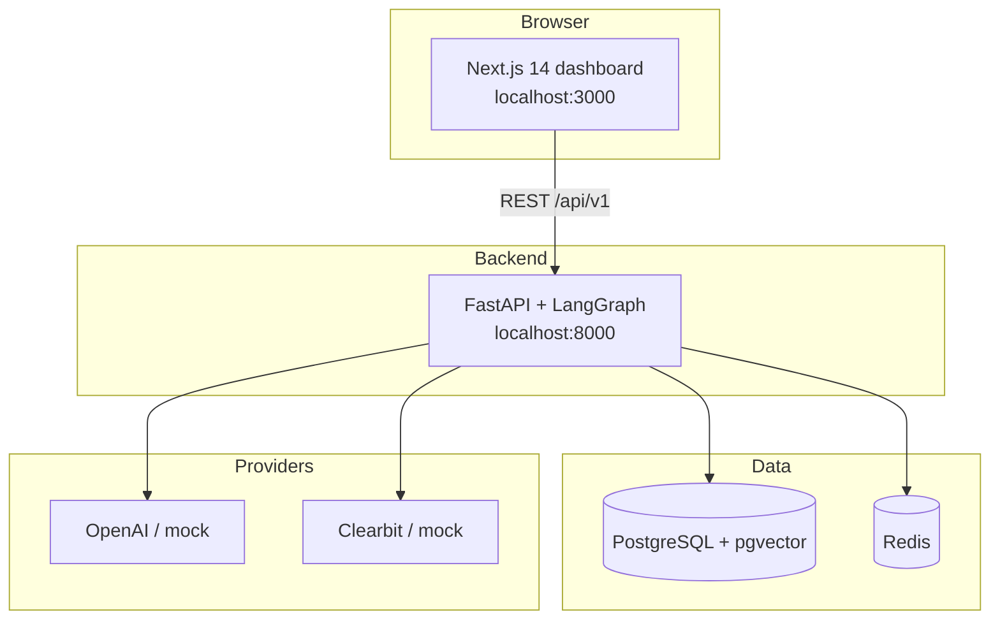

<div align="center">

# 🎯 Cortex — AI Sales Lead Qualifier

**Turn a firehose of raw leads into a ranked, evidence-backed call list — automatically.**

Cortex ingests leads, enriches them, scores them against five weighted criteria with an
LLM-driven agent, guards every score against hallucination, and delivers a daily Hot / Warm / Cold
digest — so reps spend their day on the 20% of leads that close.


</div>

---

## Why Cortex

Sales teams drown in leads and starve for **prioritization**. Reps burn hours on leads that were
never going to close, while genuinely hot prospects go cold waiting in a queue. Cortex fixes the
prioritization problem with an **agentic scoring pipeline** that is:

- **Explainable** — every score cites the exact data it used. No black box.
- **Grounded** — an anti-hallucination validator rejects any "evidence" not present in the lead record.
- **Tunable** — sales ops adjust the five criteria weights live; re-scoring is one click.
- **Provider-agnostic** — LLM, enrichment, CRM, and email are swappable adapters (config, not code).
- **Runs with zero API keys** — a deterministic mock LLM + mock enrichment let you demo the whole
  flow offline; flip a config value to use OpenAI + Clearbit in production.

📈 **See [BUSINESS_IMPACT.md](BUSINESS_IMPACT.md) for the ROI case, use-cases, and metrics.**

---

## What it does (the pipeline)



Each lead is scored on **ICP Fit (0.30)**, **Buying Intent (0.25)**, **Authority (0.20)**,
**Pain / Need (0.15)** and **Timing (0.10)**. The weighted composite (0–100) segments the lead:
**Hot ≥ 75**, **Warm 40–74**, **Cold < 40**.

---

## System architecture



---

## Quick start

### Option A — Docker (full stack, one command)

```bash
cp .env.example .env
docker compose up --build
```

Then open:
- **Dashboard** → http://localhost:3000
- **API docs (Swagger)** → http://localhost:8000/docs

The API container migrates the schema, seeds 5 criteria + 5 sample leads, and serves on `0.0.0.0:8000`.

### Option B — Native, no Docker (SQLite, zero external services)

```bash
# API
cd apps/api
python -m venv .venv && . .venv/Scripts/activate     # (or .venv/bin/activate on macOS/Linux)
pip install -e ".[dev]"
echo "DATABASE_URL=sqlite+aiosqlite:///./dev.db
LLM_PROVIDER=mock
ENRICHMENT_PROVIDER=mock" > .env
python -m scripts.seed
uvicorn app.main:app --host 0.0.0.0 --port 8000

# Web (second terminal)
cd apps/web
npm install
npm run dev
```

Same URLs as above. This path needs **no Postgres, Redis, or API keys** — the models are
dialect-portable and the mock providers run fully offline.

---

## The dashboard

| Page | What it does |
|------|--------------|
| `/` | Sortable lead table with score badges + Hot/Warm/Cold tiles; one-click **Generate Digest** |
| `/leads/[id]` | Lead detail: **score radar**, per-criterion reasoning + **cited evidence**, enrichment, **re-score** |
| `/criteria` | Live weight sliders (must sum to 1.0) that change how new leads are scored |
| `/digest` | Digest run history + on-demand generation |
| `/setup` | Guided configuration wizard |

---

## API surface (`/api/v1`)

| Method | Endpoint | Purpose |
|--------|----------|---------|
| `POST` | `/leads` | Create a lead → auto enrich + score in the background |
| `GET` | `/leads` | Paginated list with composite scores |
| `GET` | `/leads/{id}` | Lead detail incl. per-criterion scores + evidence |
| `POST` | `/leads/{id}/score` | Re-run scoring for a lead |
| `GET` / `PUT` | `/criteria` | Read / update criteria weights |
| `POST` | `/digest/generate` | Compile + record a digest run |
| `GET` | `/digest/history` | Past digest runs |
| `POST` | `/webhooks/inbound` | Ingest leads from HubSpot / Marketo / generic JSON |
| `GET` | `/health` | DB + Redis health |

Full interactive docs live at `/docs` (Swagger) and `/redoc`.

---

## Project structure

```
├── apps/
│   ├── api/                     # FastAPI + LangGraph backend
│   │   ├── app/
│   │   │   ├── agents/          # LangGraph graph, prompts, schemas, anti-hallucination validator
│   │   │   ├── adapters/        # enrichment (mock/clearbit), email, notifications
│   │   │   ├── services/        # scoring, enrichment, digest, notifications
│   │   │   ├── routers/         # leads, scoring, criteria, digest, webhooks, health
│   │   │   ├── models/          # SQLAlchemy ORM (portable Postgres/SQLite types)
│   │   │   ├── schemas/         # Pydantic request/response models
│   │   │   ├── db/              # session, base types, seed
│   │   │   └── utils/           # PII redaction, crypto
│   │   ├── alembic/             # migrations
│   │   └── tests/               # 86 pytest tests
│   └── web/                     # Next.js 14 dashboard (App Router, TS, Tailwind)
├── scripts/                     # init.sql, seed launcher
├── docs/                        # architecture + setup guides
├── docker-compose.yml
└── .env.example
```

---

## Configuration

Everything is env-driven (see [`.env.example`](.env.example)). Highlights:

| Variable | Default | Notes |
|----------|---------|-------|
| `LLM_PROVIDER` | `mock` | `mock` (offline) or `openai` (needs `OPENAI_API_KEY`) |
| `ENRICHMENT_PROVIDER` | `mock` | `mock` or `clearbit` (needs `CLEARBIT_API_KEY`) |
| `DATABASE_URL` | Postgres | Use `sqlite+aiosqlite:///./dev.db` for keyless local dev |
| `PII_SALT` | — | Salt for SHA-256 email hashing before LLM calls |

---

## Testing

```bash
cd apps/api && pytest        # 86 tests: agent, validator, digest, PII, crypto
cd apps/web && npm run type-check
```

---

## Tech stack

**Backend:** Python 3.12 · FastAPI · LangGraph · SQLAlchemy 2 (async) · Pydantic v2 · Alembic ·
structlog · slowapi
**Frontend:** Next.js 14 (App Router) · TypeScript (strict) · Tailwind CSS · SWR · Recharts
**Data / infra:** PostgreSQL 16 + pgvector · Redis 7 · Docker Compose

---

## License

[MIT](LICENSE)
