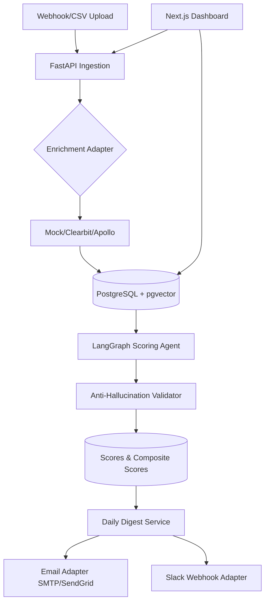

# 🎯 (Cortex) AI LEADS QUALIFIER

**Intelligent lead scoring powered by LLMs, anti-hallucination validation, and automated daily digests.**

[](https://opensource.org/licenses/MIT)
[](https://python.org)
[](https://nodejs.org)
[](https://docker.com)

---

## 📖 Elevator Pitch

The AI Sales Lead Qualifier automatically enriches inbound leads from any source (webhooks, CSV uploads, CRM integrations), scores them against your ideal customer profile using a LangGraph-powered LLM agent with anti-hallucination validation, and delivers daily digest emails to your sales team with hot/warm/cold segmentation. Built for B2B sales teams who want to prioritize high-intent prospects without manual research.

---

## ✨ Key Features

- 🧠 **LLM-Powered Scoring** - LangGraph agent evaluates leads across 5 criteria: ICP fit, buying intent, authority, pain/need, and timing
- 🛡️ **Anti-Hallucination Engine** - Fuzzy string matching validates all cited evidence exists in source data before returning scores
- 📊 **Enrichment Adapters** - Swap between Mock, Clearbit, or Apollo enrichment providers via environment variable
- 📧 **Daily Digest Emails** - Beautiful HTML emails with hot/warm/cold segmentation sent automatically each morning
- 💬 **Slack Notifications** - Block Kit payloads deliver lead summaries directly to your sales Slack channel
- 🔒 **PII Safety** - Email hashing and phone masking protect sensitive data throughout the pipeline
- 🔐 **Encrypted Secrets** - Fernet encryption secures API keys and credentials in the database
- ⚡ **Async Architecture** - FastAPI + asyncpg + Redis for high-throughput lead processing

---

## 🏗️ Architecture



---

## 🚀 Quick Start

### Prerequisites
- Docker & Docker Compose
- Python 3.12+ (for local development)
- Node 20+ (for frontend development)

### 1. Clone & configure
```bash
git clone <repository-url> && cd ai-sales-qualifier
cp .env.example .env
```

### 2. Start infrastructure
```bash
docker compose up -d  # Starts PostgreSQL (pgvector) + Redis
```

### 3. Run migrations & seed
```bash
cd apps/api
alembic upgrade head
python ../scripts/seed.py
```

### 4. Launch applications
```bash
# Terminal 1: Backend API
cd apps/api && uvicorn app.main:app --reload --host 0.0.0.0 --port 8000

# Terminal 2: Frontend
cd apps/web && npm install && npm run dev
```

Open http://localhost:3000 to access the dashboard. API docs at http://localhost:8000/docs.

---

## ⚙️ Configuration

| Variable | Description | Default |
|----------|-------------|---------|
| `LLM_PROVIDER` | LLM backend (`openai`, `anthropic`, `mock`) | `mock` |
| `ENRICHMENT_PROVIDER` | Enrichment service (`mock`, `clearbit`, `apollo`) | `mock` |
| `EMAIL_PROVIDER` | Email delivery (`console`, `smtp`, `sendgrid`) | `console` |
| `DATABASE_URL` | PostgreSQL connection string | `postgresql+asyncpg://...` |
| `REDIS_URL` | Redis connection string | `redis://localhost:6379` |
| `OPENAI_API_KEY` | OpenAI API key (required if LLM_PROVIDER=openai) | - |
| `ENCRYPTION_KEY` | 32-byte Fernet key for secret encryption | Generate with `cryptography.fernet.Fernet.generate_key()` |

Generate encryption key:
```python
from cryptography.fernet import Fernet; print(Fernet.generate_key().decode())
```

---

## 📁 Project Structure

```
ai-sales-qualifier/
├── apps/
│   ├── api/                 # FastAPI backend
│   │   ├── app/
│   │   │   ├── adapters/    # Enrichment, email, notification adapters
│   │   │   ├── agents/      # LangGraph scoring agent & prompts
│   │   │   ├── db/          # SQLAlchemy session & base
│   │   │   ├── models/      # ORM models (leads, scores, criteria)
│   │   │   ├── routers/     # API endpoints
│   │   │   ├── schemas/     # Pydantic request/response models
│   │   │   ├── services/    # Business logic (digest, notifications)
│   │   │   ├── templates/   # Jinja2 email templates
│   │   │   └── utils/       # PII redaction, encryption
│   │   ├── tests/           # pytest unit & integration tests
│   │   └── alembic/         # Database migrations
│   └── web/                 # Next.js 14 frontend
│       ├── src/
│       │   ├── app/         # App router pages
│       │   ├── components/  # Reusable UI components
│       │   └── lib/         # API client, hooks, types
│       └── public/          # Static assets
├── scripts/                 # Utility scripts (seed, etc.)
├── docs/                    # Technical documentation
├── docker-compose.yml       # Local development infrastructure
├── CLAUDE.md               # AI agent context file
└── FRONTEND_BUILD_GUIDE.md # Frontend development guide
```

---

## 🧪 Testing

```bash
# Backend tests
cd apps/api && pytest --cov=app --cov-report=term-missing

# Frontend tests
cd apps/web && npm run test

# Coverage target: 80%+
```

---

## 🤝 Contributing

We welcome contributions! Please see [CONTRIBUTING.md](./CONTRIBUTING.md) for setup instructions and PR guidelines.

### Development Workflow
1. Fork the repository
2. Create a feature branch (`git checkout -b feat/amazing-feature`)
3. Make changes with tests
4. Ensure all tests pass and coverage >80%
5. Submit a pull request

---

## 📄 License

This project is licensed under the MIT License - see the [LICENSE](./LICENSE) file for details.

---

## 🙏 Acknowledgments

Built with:
- [FastAPI](https://fastapi.tiangolo.com/) - Modern Python web framework
- [LangGraph](https://langchain-ai.github.io/langgraph/) - Stateful LLM agent orchestration
- [Next.js 14](https://nextjs.org/) - React framework with App Router
- [PostgreSQL + pgvector](https://github.com/pgvector/pgvector) - Vector similarity search
- [SQLAlchemy 2.0](https://docs.sqlalchemy.org/) - Async ORM
- [Recharts](https://recharts.org/) - Composable charting library
# Cortex
