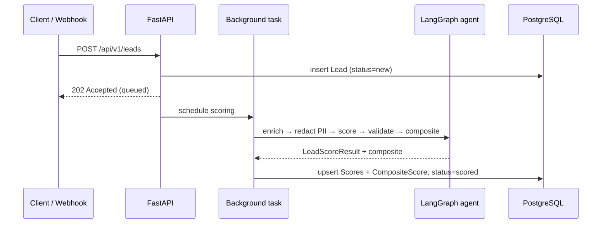

# Architecture

## Overview
Cortex is a monorepo with two deployables — a FastAPI/LangGraph API (`apps/api`) and a Next.js
dashboard (`apps/web`) — backed by PostgreSQL (pgvector) and Redis. Every external dependency
(LLM, enrichment, CRM, email) sits behind an **adapter** selected by configuration, so the core
pipeline never hard-codes a vendor.

## Request → score sequence

## The LangGraph scoring agent (`app/agents/graph.py`)
A `StateGraph` with five sequential nodes:

1. **prepare_context** — validate lead data + active criteria are present.
2. **redact_pii** — strip raw email/phone before the LLM sees the record.
3. **score_lead** — call the provider (OpenAI structured output, or the deterministic grounded mock)
   to produce a strict `LeadScoreResult`.
4. **validate_output** — the anti-hallucination validator checks every cited evidence item against the
   source data (exact substring, numeric digit-run, then fuzzy ≥ 0.85), plus criteria-name and range checks.
5. **calculate_composite** — weighted 0–100 score; sets the disqualify flag below 40.

The service layer (`app/services/scoring.py`) runs the graph, then persists per-criterion `Score`
rows and the `CompositeScore`, and advances the lead's status.

## Anti-hallucination (`app/agents/validator.py`)
LLMs invent evidence. The validator flattens the lead record (including numeric fields) into a
searchable corpus and verifies each `cited_evidence` string by (1) exact substring, (2) numeric
digit-run match ignoring `$`/comma formatting, then (3) fuzzy similarity. Ungrounded evidence is
flagged; if too many criteria are unverifiable the result is marked for review.

## Data model
| Table | Purpose |
|-------|---------|
| `leads` | Contact + company + `enriched_data` (JSON) + status |
| `scores` | Per-criterion score, reasoning, cited evidence, confidence, trace metadata |
| `composite_scores` | Weighted 0–100 score, summary, suggested action, disqualify flag |
| `criteria_configs` | The five weighted criteria (weights sum to 1.0) |
| `digest_runs` | History of Hot/Warm/Cold digest runs |
| `app_config` | Key/value app config (optionally encrypted) |

Models use **portable column types** (`JSONType`, `PortableUUID` in `app/db/base.py`) so the exact
same schema runs on Postgres (JSONB + native UUID) and SQLite (JSON + CHAR) for local dev and CI.

## Frontend
Next.js App Router with a thin typed API client (`src/lib/api.ts`) that unwraps the `StandardResponse`
envelope, SWR hooks (`src/lib/hooks.ts`) with live refresh, and pages for the dashboard, lead detail
(score radar + evidence), criteria weights, and digest history. Recharts is loaded via
`next/dynamic` with `ssr: false` to avoid hydration mismatches.

## Configuration & providers
`app/config.py` (pydantic-settings) reads all settings from env. Provider factories
(`app/services/enrichment.py`, the `LLM_PROVIDER` switch in the agent, email/notification adapters)
resolve the concrete implementation and fall back to mocks when credentials are absent.
